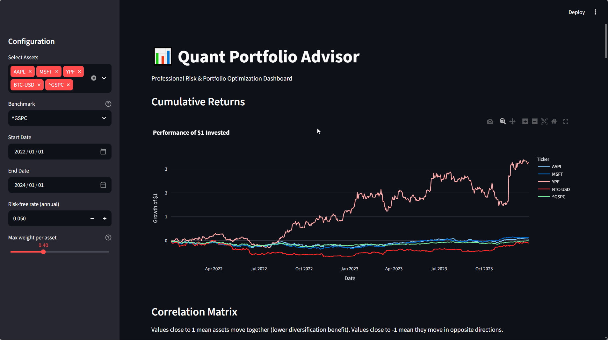
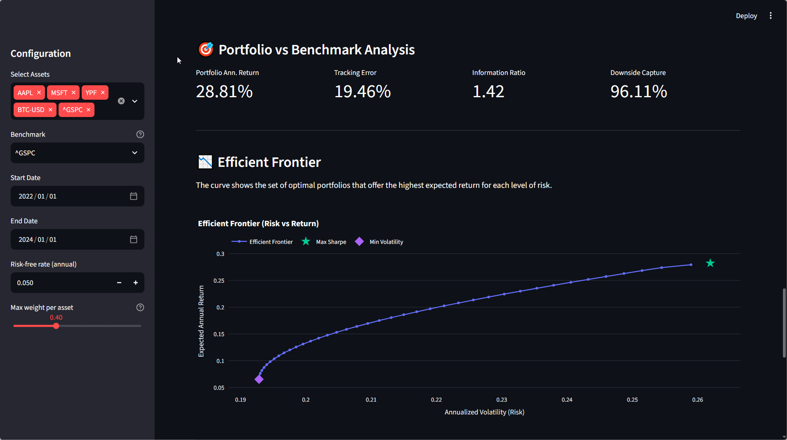
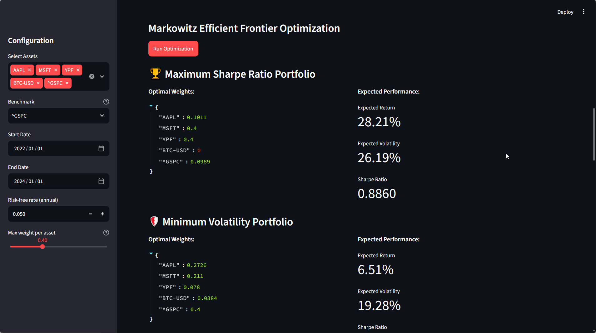
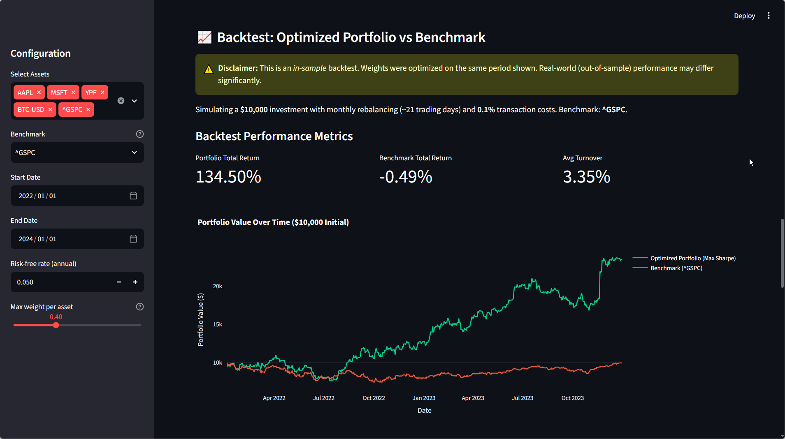
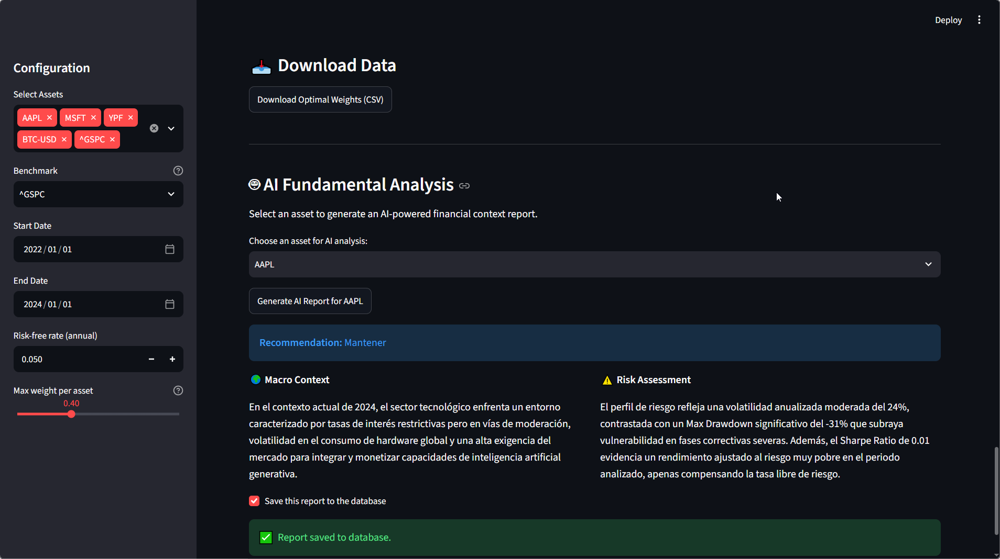

# 📊 Quant Portfolio Advisor

An interactive, AI-powered quantitative finance dashboard designed for investment advisors, portfolio managers, and financial analysts. This tool automates market data ingestion, calculates institutional-grade risk metrics, optimizes asset allocation using Markowitz (Efficient Frontier) and HRP, runs realistic backtests, and generates AI-driven fundamental analysis.

## 🎯 The Business Problem
Investment advisors and analysts spend hours manually extracting data, calculating risk metrics in Excel, and writing context reports for clients. **Quant Portfolio Advisor** automates this entire workflow, allowing professionals to focus on strategic decisions and client relationships. It bridges the gap between complex quantitative models and actionable insights.

---

## 🖥️ Dashboard Showcase

### 1. Cumulative Returns
Visualize how a portfolio of selected assets performs over time. 


### 2. Correlation Matrix & Individual Risk Metrics
Understand how assets correlate (crucial for diversification) and review a comprehensive table of institutional metrics including Volatility, Sharpe, Sortino, VaR, CVaR, and Calmar Ratios.


### 3. Portfolio Optimization (Markowitz & HRP)
The engine finds the optimal weights using Ledoit-Wolf shrinkage and max-weight constraints (e.g., 40% per asset) to avoid extreme concentration, offering Maximum Sharpe, Minimum Volatility, and Hierarchical Risk Parity portfolios.


### 4. Efficient Frontier & Portfolio Analytics
Visualizing the Efficient Frontier curve with the optimal portfolios marked. Includes advanced portfolio analytics vs the benchmark: Tracking Error, Information Ratio, and Downside Capture.


### 5. Realistic Backtest
Simulating a $10,000 investment with transaction costs (0.1%) and monthly rebalancing against a benchmark.


### 6. AI Fundamental Analysis
Generating professional macro context and risk assessments using Google's Gemini AI, based on the quantitative metrics calculated by the engine.


---

## 🚀 Key Features

*   **Automated Data Ingestion:** Fetches adjusted historical prices (handling splits and dividends) via `yfinance`, with caching to avoid rate limits.
*   **Institutional Risk Engine:** Calculates Volatility, Max Drawdown, Sharpe, Sortino, VaR, CVaR, and Calmar ratios.
*   **Advanced Portfolio Optimization:**
    *   Markowitz Efficient Frontier (Max Sharpe & Min Volatility).
    *   Hierarchical Risk Parity (HRP) for robustness during market stress.
    *   Ledoit-Wolf covariance shrinkage and max-weight constraints.
*   **Portfolio vs Benchmark Analytics:** Tracking Error, Information Ratio, and Downside Capture.
*   **AI Fundamental Analysis:** Integrates Google's `gemini` to generate macro context and risk assessments based on the calculated metrics, with a fallback system for high demand.
*   **Data Persistence:** Saves AI reports and optimization results locally using SQLite.
*   **Interactive UI:** Built with Streamlit and Plotly for a seamless, responsive experience.

---

## 🛠️ Tech Stack
*   **Language:** Python 3.10+
*   **Data Processing:** Pandas, NumPy, yfinance
*   **Optimization:** PyPortfolioOpt, SciPy
*   **Artificial Intelligence:** Google GenAI SDK (Gemini)
*   **Web Interface:** Streamlit, Plotly
*   **Database:** SQLite3

---

## ⚙️ How to Run Locally

1. **Clone the repository:**
   ```bash
   git clone https://github.com/yourusername/quant-portfolio-advisor.git
   cd quant-portfolio-advisor

   Create and activate a virtual environment:

bash
python -m venv .venv
# Windows:
.venv\Scripts\activate
# Mac/Linux:
source .venv/bin/activate
Install dependencies:

bash
pip install -r requirements.txt
Set up environment variables:
Create a .env file in the root directory and add your Gemini API key:

text
GEMINI_API_KEY=your_google_gemini_api_key
Run the application:

bash
streamlit run app/dashboard.py
📈 Future Roadmap (Business & Product)
RAG Integration: Implement Retrieval-Augmented Generation to read real-time financial news and central bank reports to enrich the AI context.

Multi-Currency Support: Handle ARS/USD conversion dynamically for Argentine CEDEARs and local bonds.

PDF Reporting: Export the entire dashboard and AI analysis into a professional PDF for clients.

Deployment: Host on Streamlit Community Cloud for public access.

Disclaimer: This tool is for educational and informational purposes only. It does not constitute financial advice. Past performance is not indicative of future results.